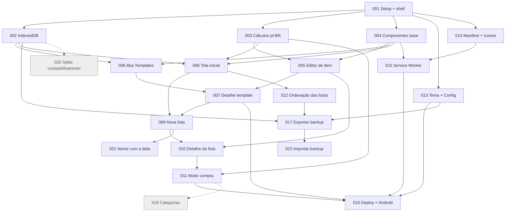

# 🧺 Cestinha — Quadro de cards

> **Fonte:** [docs/refinamento.md](../refinamento.md), refinamento de 08/11/2026 (versão com RNF10, código em inglês), com as revisões de 10/11/2026 (nome sugerido com a data, ordenação das listas, descarte do RF14 e do RF19, backup manual no MVP)
> **Gerado em:** 08/11/2026 · **Atualizado em:** 10/11/2026 (CARD-021 e CARD-022; CARD-012 e CARD-018 descartados; backup: CARD-017 atualizado e CARD-023 novo) · **Total:** 23 cards (19 MVP + 2 depois + 2 descartados)

## Cards

| ID | Título | Contexto | Tipo | Compl. | Prioridade | Status | Depende de | Modelo |
|---|---|---|---|---|---|---|---|---|
| [CARD-001](01-fundacao/CARD-001-setup-projeto-app-shell.md) | Setup do projeto e app shell | fundacao | setup | M | mvp | done | — | — |
| [CARD-002](01-fundacao/CARD-002-camada-de-dados-indexeddb.md) | Camada de dados com IndexedDB | fundacao | dados | M | mvp | done | 001 | — |
| [CARD-003](01-fundacao/CARD-003-calculos-e-formatacao.md) | Cálculos, formatação e entrada numérica pt-BR | fundacao | feature | M | mvp | done | 001 | — |
| [CARD-004](02-componentes/CARD-004-paineis-dialogos-e-avisos.md) | Componentes base: painel, diálogos e avisos | componentes | feature | M | mvp | done | 001 | — |
| [CARD-005](02-componentes/CARD-005-editor-de-item.md) | Editor de item (T04) | componentes | feature | M | mvp | done | 003, 004 | — |
| [CARD-006](03-templates/CARD-006-aba-templates.md) | Aba Templates: listar e criar (T05) | templates | feature | P | mvp | done | 002, 004 | — |
| [CARD-007](03-templates/CARD-007-detalhe-do-template.md) | Detalhe do template (T06) | templates | feature | M | mvp | done | 005, 006 | — |
| [CARD-008](04-listas/CARD-008-tela-inicial-listas.md) | Tela inicial: Listas (T01) | listas | feature | M | mvp | done | 002, 003, 004 | — |
| [CARD-009](04-listas/CARD-009-nova-lista.md) | Nova lista: template ou em branco (T02) | listas | feature | M | mvp | done | 007, 008 | — |
| [CARD-010](04-listas/CARD-010-detalhe-da-lista.md) | Detalhe da lista: itens, renomear, excluir (T03.1) | listas | feature | M | mvp | done | 005, 009 | — |
| [CARD-011](04-listas/CARD-011-modo-compra.md) | Modo compra: marcar, progresso e totais (T03.2) | listas | feature | M | mvp | done | 003, 010 | — |
| [CARD-013](05-configuracoes/CARD-013-tema-e-configuracoes.md) | Tema claro/escuro e Configurações (T07) | configuracoes | feature | P | mvp | done | 001 | — |
| [CARD-014](06-pwa/CARD-014-manifest-e-icones.md) | Manifest e ícones | pwa | infra | P | mvp | done | 001 | — |
| [CARD-015](06-pwa/CARD-015-service-worker-offline.md) | Service Worker e funcionamento offline | pwa | infra | M | mvp | done | 004, 014 | — |
| [CARD-016](06-pwa/CARD-016-deploy-github-pages.md) | Deploy no GitHub Pages e validação no Android | pwa | infra | M | mvp | done | 007, 011, 013, 015 | — |
| [CARD-021](04-listas/CARD-021-nome-sugerido-com-data.md) | Nome sugerido da lista com a data de hoje | listas | feature | P | mvp | done | 009 | haiku |
| [CARD-022](04-listas/CARD-022-ordenacao-das-listas.md) | Ordenação das listas na tela inicial | listas | feature | M | mvp | done | 008 | sonnet |
| [CARD-017](05-configuracoes/CARD-017-exportar-backup.md) | Backup: exportar dados | configuracoes | feature | M | mvp | done | 002, 013, 022 | sonnet |
| [CARD-023](05-configuracoes/CARD-023-importar-backup.md) | Backup: importar dados | configuracoes | feature | M | mvp | done | 017 | sonnet |
| [CARD-018](07-pos-mvp/CARD-018-preco-sugerido.md) | ~~Preço sugerido com base na última compra~~ (descartado) | pos-mvp | feature | M | depois | descartado | 011 | — |
| [CARD-019](07-pos-mvp/CARD-019-categorias-do-mercado.md) | Categorias/setores do mercado | pos-mvp | feature | M | depois | todo | 011 | — |
| [CARD-020](07-pos-mvp/CARD-020-spike-compartilhamento.md) | Spike: compartilhamento e sincronização | pos-mvp | spike | M | depois | todo | 002 | — |
| [CARD-012](07-pos-mvp/CARD-012-sugestao-adicionar-ao-template.md) | ~~Sugestão "adicionar ao template" (RF14)~~ (descartado) | pos-mvp | feature | P | depois | descartado | 010 | — |

## Ordem sugerida de execução (ondas)

Os cards de uma mesma onda podem ser feitos em qualquer ordem, ou em paralelo.

| Onda | Cards | Marco |
|---|---|---|
| 1 | 001 | Projeto navegável com shell e tokens de tema |
| 2 | 002 · 003 · 004 · 013 · 014 | Dados, cálculos, componentes, tema e manifest |
| 3 | 005 · 006 · 008 | Editor de item, aba Templates, tela inicial |
| 4 | 007 | Templates completos (F1) |
| 5 | 009 | Gerar lista do dia (F2) |
| 6 | 010 | Ajustar a lista |
| 7 | 011 | Compra no mercado (F3) |
| 8 | 015 · 016 | Offline (015, antes do 016) e **MVP publicado e validado no Android** |
| 9 | 021 · 022 | Revisão de 10/11: nome sugerido com a data e ordenação das listas (independentes entre si); depois, deploy com `APP_VERSION` aumentado |
| 10 | 017 → 023 | Revisão de 10/11 (backup): exportar e depois importar; os dois vão no mesmo deploy, com `APP_VERSION` aumentado |
| Pós-MVP | 019 · 020 | Conforme prioridade após o uso real (012 e 018 foram descartados) |

> **Nota (CARD-015 movido para a onda 8):** o CARD-015 saiu da onda 3 e deve ser feito imediatamente antes do CARD-016. A lista de arquivos do app shell que o Service Worker coloca em cache só fica estável quando todos os arquivos do app estão prontos; fazê-lo antes obrigaria a revisar a lista a cada card novo. As dependências (004, 014) já estão done.

## Grafo de dependências

## Matriz de rastreabilidade

### Requisitos funcionais

| Requisito | Prioridade | Cards |
|---|---|---|
| RF01 Criar template | MVP | 006 |
| RF02 Editar template | MVP | 007, 005 |
| RF03 Excluir template | MVP | 007 |
| RF04 Listar templates | MVP | 006 |
| RF05 Lista a partir de template | MVP | 009, 021 |
| RF06 Lista em branco | MVP | 009, 008, 021 |
| RF07 Editar itens da lista | MVP | 010, 005 |
| RF08 Renomear/excluir lista | MVP | 008, 010 |
| RF09 Tela inicial | MVP | 008, 022 |
| RF10 Marcar item | MVP | 011 |
| RF11 Informar valor | MVP | 005, 010 |
| RF12 Subtotal | MVP | 003, 005, 010, 011 |
| RF13 Totais previsto/no carrinho | MVP | 003, 011 |
| RF14 Sugestão adicionar ao template | Descartado | 012 (descartado) |
| RF15 Tema | MVP | 013 |
| RF16 Instalável e offline | MVP | 014, 015, 016 |
| RF17 Lista compartilhada | Depois | 020 (spike) |
| RF18 Categorias | Depois | 019 |
| RF19 Preço sugerido | Descartado | 018 (descartado) |
| RF20 Exportar/importar (backup) | MVP | 017, 023 |
| RF21 Ordenar listas | MVP | 022 |

### Regras de negócio e requisitos não funcionais

| Requisito | Cards |
|---|---|
| RN01–RN03 Unidade, quantidade, valor | 003, 005 |
| RN04–RN07 Subtotal, totais, progresso | 003, 011 |
| RN08 Lista é cópia independente | 002, 009, 010 |
| RN09 Sem estado "finalizada" | 008, 011 |
| RN10 Comparação de nomes normalizada (descartada com o RF14) | 003 |
| RN11 Nome obrigatório e pré-preenchido (com a data de hoje desde a revisão 10/11) | 004, 006, 007, 009, 021 |
| RN12 Listas ilimitadas | 008 |
| RN13 Excluir template preserva listas | 002, 007 |
| RN14 Marcados riscados e no fim | 011 |
| RN15 Formato pt-BR | 003, 021 |
| RN16 Regras de ordenação das listas | 022 |
| RN17 Importação: substitui tudo, tudo ou nada, validação estrita | 023 |
| RN18 Exportação e "Último backup" | 017 |
| RNF01 PWA instalável | 014, 016 |
| RNF02 Offline total | 015, 016, 022 |
| RNF03 IndexedDB nativo | 002 |
| RNF04 Nenhum dado sai do aparelho (exceto o backup enviado pelo usuário) | 001, 015, 017 |
| RNF05 Resposta imediata | 011, 015, 016 |
| RNF06 Uso com uma mão, teclado decimal | 001, 004, 005, 011, 016, 022 |
| RNF07 `storage.persist()` e backup manual | 002, 017, 023 |
| RNF08 Acessibilidade básica | 001, 004, 008, 011, 013, 016, 022 |
| RNF09 Tema segue o sistema | 013 |
| RNF10 Código em inglês, UI em pt-BR | 001 (vale para todos) |

## Pendências que não são cards

- [ ] **Arte do ícone** do app (CARD-014). Um desenho provisório serve para o MVP.
- [ ] **Repositório no GitHub** criado, com Pages habilitado (CARD-016).
- [ ] Baixar o **Tailwind standalone v4** (`tailwindcss-windows-x64.exe`) e instalar a extensão **Live Server** no VS Code (CARD-001).
- [ ] Pós-MVP: categorias fixas ou personalizáveis, e onde ficam os marcados (CARD-019).
- [ ] Pós-MVP: decisão de abrir mão do "sem servidor/sem login" para o compartilhamento (CARD-020).

## Premissas assumidas

- Os cards ficam em `docs/cards/`, versionados com o código.
- Valem os nomes em inglês (RNF10), mesmo onde a seção 12 do refinamento ainda usa português:
  - rotas: `#/lists`, `#/list/:id`, `#/templates`, `#/template/:id`, `#/settings`;
  - views: `lists`, `list`, `templates`, `template`, `settings`.
- Além da estrutura sugerida no refinamento, foram adicionados:
  - `src/router.js`;
  - `src/model.js` (fábricas puras);
  - `src/ui/` (componentes reutilizáveis);
  - `version.js` (fonte única da versão);
  - `tests/` e `tools/`.
- A máquina não tem Node nem Python, então:
  - o servidor local é o Live Server do VS Code;
  - os testes automatizados ficam numa página no navegador, sem dependências, só para `calc.js`;
  - o resto é validado manualmente.
- O `styles/output.css` é gerado com `--minify` e commitado, porque o GitHub Pages não roda build. Há também um `.nojekyll` na raiz.
- A atualização do Service Worker é confirmada pelo usuário ("Nova versão disponível"), sem recarregar no meio da compra.
- Painéis via `<dialog>`, e o voltar do Android fecha o painel aberto (`history.pushState`).
- Os templates são ordenados por `updatedAt` desc na aba Templates.
- Após criar uma lista, o app abre a lista direto. Ao voltar, ela está no topo da tela inicial.
- As abas inferiores aparecem só nas telas de topo (Listas e Templates).
- Item adicionado na hora entra desmarcado, e o usuário marca com um toque.
- Excluir item pelo editor não pede confirmação.
- A data do card de lista usa o formato `08 de nov. de 2026`.
- (Revisão 10/11) A formatação `DD/MM/AAAA` do nome sugerido fica em `calc.js` (`formatShortDate`), junto das outras formatações pt-BR (CARD-021).
- (Revisão 10/11) A preferência e as regras de ordenação ficam num módulo novo, `src/listSort.js`, no padrão de `src/theme.js`, e esse módulo entra no `APP_SHELL` (CARD-022).
- (Revisão 10/11) O painel de opções (`openActionSheet`) ganha a propriedade opcional `selected` para marcar a opção atual com ✓. Os chamadores atuais não mudam (CARD-022).
- (Revisão 10/11) Os cards 021 e 022 não têm testes automatizados (CLAUDE.md, "No unit tests"). A validação é manual, pelo roteiro de cada card.
- Os cards criados até o CARD-020 não têm `modelo_sugerido` e são implementados direto na sessão principal. Os cards a partir do CARD-021 têm o campo e seguem a delegação a subagente descrita no CLAUDE.md.
- (Revisão 10/11) CARD-012 (RF14) e CARD-018 (RF19) foram descartados: status `descartado`, arquivos mantidos só como registro. Não implementar.
- (Revisão backup) O backup foi dividido em dois cards: exportar (CARD-017, revisto e movido de `07-pos-mvp/` para `05-configuracoes/`) e importar (CARD-023). O CARD-017 renderiza o botão "Importar dados" sem ação; o CARD-023 o liga. Os dois vão juntos no mesmo deploy.
- (Revisão backup) A lógica de backup fica num módulo novo, `src/backup.js` (entra no `APP_SHELL`), e a gravação atômica da importação em `db.js` (`replaceAllData`), sem nova versão do banco.
- (Revisão backup) No iPhone, `navigator.share` exige o gesto do usuário: o arquivo é montado ao abrir Configurações, e o clique chama o compartilhamento sem `await` antes (CARD-017).

## Perguntas em aberto (herdadas do refinamento)

| # | Pergunta | Padrão adotado nos cards |
|---|---|---|
| 4 | Permitir item com nome repetido na mesma lista? | Permitir (CARD-007, CARD-010) |
| 5 | Levar o valor para o template ao aceitar a sugestão do RF14? | Encerrada: CARD-012 e CARD-018 descartados (10/11) |
| Risco 2 | A tela inicial cresce sem limite | Renderizar tudo no MVP e reavaliar após o uso real (CARD-008). A ordenação (CARD-022) ajuda a achar listas, mas não resolve o crescimento |
| 8 | Esconder a data repetida no card quando o nome já é a data? | Manter as duas por enquanto (CARD-021) |
| Riscos 9 e 10 | Nomes iguais no mesmo dia; "Nome A–Z" não é cronológico com nomes em data | Aceitos (CARD-021, CARD-022) |
| Riscos 12 a 14 | Esquecer de exportar; importar o arquivo errado; compartilhar e escolher arquivo funcionam diferente no Android e no iPhone | Aceito e mitigado: "Último backup" (CARD-017), confirmação com a data e o resumo (CARD-023), download como alternativa e validação nos dois aparelhos após o deploy |

## Resumo

| | P | M | G | Total |
|---|---|---|---|---|
| **MVP** | 4 | 15 | 0 | 19 |
| **Depois** | 0 | 2 | 0 | 2 |
| **Descartados** | 1 | 1 | 0 | 2 |
| **Total** | 5 | 18 | 0 | **23** |

Por tipo: 17 feature · 3 infra · 1 setup · 1 dados · 1 spike.

Por modelo sugerido: 1 haiku (021) · 3 sonnet (022, 017, 023) · 19 sem campo (anteriores à regra; o CARD-017 ganhou o campo ao ser revisto).

## Instruções para quem implementar um card

Valem as regras do [CLAUDE.md](../../CLAUDE.md), que prevalecem sobre o card. Em resumo:
- Leia o card inteiro, as premissas deste índice e as seções do refinamento em "Referências". Confira se os cards de `depende_de` estão `done`.
- Siga o Detalhamento técnico e respeite o "Fora do escopo". Se precisar desviar, registre o motivo em Observações.
- Não crie testes automatizados nem páginas de teste.
- Todo arquivo novo do app entra no `APP_SHELL` do `sw.js`. Classes Tailwind novas exigem regerar o `styles/output.css`.
- **Card com `modelo_sugerido`:** a sessão principal delega a implementação a um subagente com esse modelo, revisa o diff contra os critérios de aceite e leva as dúvidas ao usuário. O subagente não commita nem muda o status.
- Ao concluir, marque `status: done` no card **e** nesta tabela, e commite com o prefixo do card (ex.: `CARD-021: nome sugerido com a data`).
