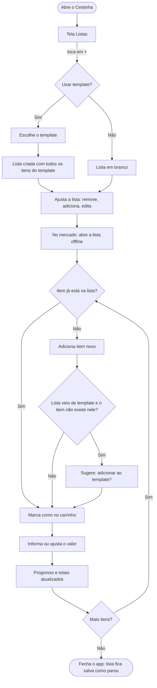
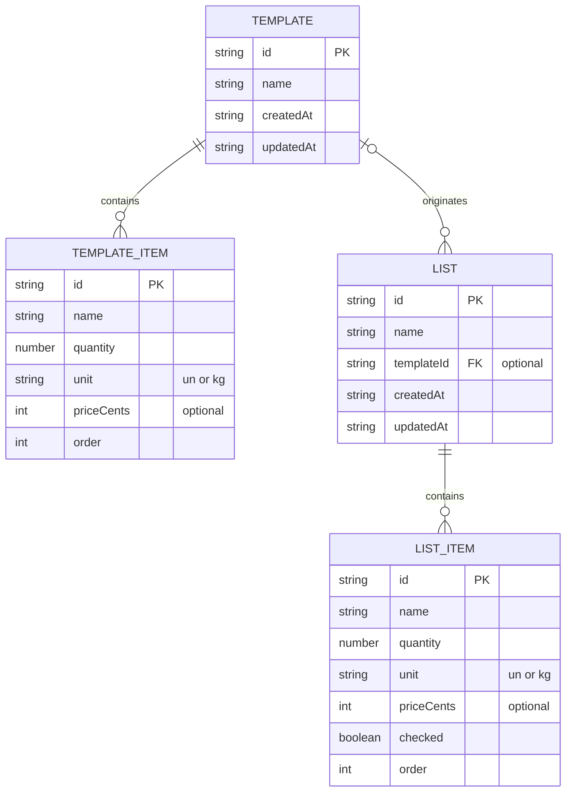

# 🧺 Cestinha — Documento de Refinamento

> **Data:** 08/11/2026 · **Autor:** Thales Alves · **Status:** MVP refinado, pronto para iniciar o desenvolvimento
>
> **Revisão 10/11/2026:** nome sugerido da lista passa a ser a data de hoje (RN11 alterada) e as listas ganham seletor de ordenação (RF09 alterado, RF21 e RN16 novos, T01 alterada).

---

## 1. Visão geral

**Problema**
As compras de mercado se repetem muito de uma vez para outra: no geral são os mesmos itens, com alguns acréscimos e remoções. No app usado hoje (Listonic), não existe uma "lista padrão": para não montar tudo do zero, a saída é duplicar uma lista antiga. Só que a lista antiga reflete o que foi *planejado* naquele dia, inclusive itens que acabaram não sendo comprados, então a nova lista já nasce enviesada.

**Solução**
Um PWA de lista de compras, offline, em que o usuário mantém **templates** (listas padrão) separados das compras do dia. A partir de um template, ele gera a **lista do dia** com todos os itens já incluídos, ajusta o que precisar e usa a lista no mercado: marca o que coloca no carrinho, informa os valores e acompanha os totais. O template se ajusta com o tempo, porque o app sugere incluir nele os itens adicionados durante a compra.

**Público-alvo**
Uso pessoal (o próprio autor), em celular Android.

**Proposta de valor**
Lista do dia pronta em segundos a partir de uma base confiável, que melhora a cada compra, com o controle de gastos na hora (previsto x no carrinho).

**Sinais de sucesso**
- Montar a lista do dia a partir de um template em 1 a 2 minutos.
- Listas geradas sem "itens fantasma" de compras anteriores.
- Templates se mantendo atualizados via sugestão, sem precisar editá-los à parte.
- Substituir de vez o Listonic no uso do dia a dia.

---

## 2. Escopo

### ✅ MVP
- Vários templates (criar, editar, renomear, excluir).
- Gerar lista a partir de um template, com todos os itens incluídos.
- Criar lista em branco (sem template).
- Várias listas existindo ao mesmo tempo.
- Itens com nome, quantidade (aceita decimais), unidade (`un` / `kg`) e valor opcional.
- Modo compra: marcar item como "no carrinho", adicionar item na hora, informar/editar valor.
- Subtotal por item (quantidade × valor) e dois totais: **previsto** e **no carrinho**.
- Barra de progresso por lista (itens marcados / total).
- Sugestão de "adicionar ao template" ao incluir item novo numa lista gerada de template.
- Lista única na tela inicial, que funciona também como histórico.
- Ordenação das listas na tela inicial por critério (mais recentes, mais antigas, alteradas por último, nome A–Z), com a escolha lembrada.
- Nome da lista nova sugerido com a data de hoje (DD/MM/AAAA).
- Tema claro e escuro.
- Funcionamento 100% offline e instalável no celular.

### ⏳ Depois
- Lista compartilhada (exige login e sincronização).
- Categorias/setores do mercado organizando a lista.
- Preço sugerido com base na última compra.
- Backup: exportar/importar dados.

### 🚫 Não-objetivos (MVP)
- Contas, login ou qualquer servidor/back-end.
- Publicação em lojas de aplicativos.
- Botão/estado de "finalizar compra".
- Combinar vários templates numa mesma lista (para isso, cria-se um template novo).
- Unidade em gramas (usa-se `kg` com decimais, ex.: 0,3 kg).
- Histórico de preços por item.
- Reordenar listas manualmente (arrastar) ou fixar listas no topo — o seletor de critério atende à necessidade.
- Ordenação na aba Templates (segue por data de alteração, da mais recente para a mais antiga).

---

## 3. Perfis de usuário

| Perfil | Descrição | O que pode fazer |
|---|---|---|
| **Usuário** | Dono do aparelho; único perfil do MVP | Tudo: gerenciar templates, listas, itens e configurações |

Não há login nem distinção de permissões. Os dados pertencem ao navegador/aparelho onde o app está instalado.

---

## 4. Requisitos funcionais

| ID | Requisito (ação → resposta do sistema) | Prioridade |
|---|---|---|
| RF01 | Usuário cria um template informando o nome → template é salvo vazio e aparece na aba Templates | MVP |
| RF02 | Usuário edita um template (renomear; adicionar, editar e remover itens) → alterações são salvas na hora | MVP |
| RF03 | Usuário exclui um template → sistema pede confirmação e remove o template, sem afetar listas já geradas | MVP |
| RF04 | Usuário abre a aba Templates → sistema exibe todos os templates com nome e quantidade de itens | MVP |
| RF05 | Usuário cria uma lista a partir de um template → sistema cria uma lista nova com cópia de todos os itens do template, todos incluídos e desmarcados | MVP |
| RF06 | Usuário cria uma lista em branco → sistema cria uma lista vazia | MVP |
| RF07 | Usuário adiciona, edita ou remove itens de uma lista → lista é atualizada e totais/progresso recalculados | MVP |
| RF08 | Usuário renomeia ou exclui uma lista → sistema aplica a alteração (exclusão com confirmação) | MVP |
| RF09 | Usuário abre o app → tela inicial exibe todas as listas, na ordem escolhida pelo RF21 (padrão: da mais recente para a mais antiga), com barra de progresso e total previsto | MVP |
| RF10 | Usuário marca/desmarca um item → item muda de estado ("no carrinho"), progresso e total no carrinho são recalculados | MVP |
| RF11 | Usuário informa ou edita o valor de um item (preço por unidade ou por kg) → valor é salvo e subtotal calculado | MVP |
| RF12 | Sistema exibe o subtotal de cada item com valor (quantidade × valor) | MVP |
| RF13 | Sistema exibe na lista o **total previsto** (todos os itens com valor) e o **total no carrinho** (itens marcados com valor) | MVP |
| RF14 | Usuário adiciona à lista um item que não existe no template de origem → sistema pergunta se quer adicioná-lo também ao template; se sim, o item é incluído no template | Depois (descartado do MVP) |
| RF15 | Usuário troca o tema nas configurações (claro, escuro ou automático) → interface muda na hora e a escolha fica salva | MVP |
| RF16 | Usuário instala o app na tela inicial do Android e o utiliza sem internet → todas as funcionalidades continuam disponíveis | MVP |
| RF17 | Usuário compartilha uma lista com outra pessoa, que pode editá-la em tempo real | Depois |
| RF18 | Sistema organiza os itens da lista por categoria/setor do mercado | Depois |
| RF19 | Sistema sugere o valor de um item com base na última compra | Depois |
| RF20 | Usuário exporta e importa seus dados em arquivo | Depois |
| RF21 | Usuário escolhe a ordem das listas na tela inicial (Mais recentes, Mais antigas, Alteradas por último, Nome A–Z) → listas são reordenadas na hora e a escolha fica salva para as próximas aberturas | MVP |

### Critérios de aceite (principais)

**RF05 — Criar lista a partir de template**
- **Dado** que existe o template "Compra do mês" com 20 itens
- **Quando** o usuário toca em "+", escolhe esse template e confirma o nome da lista
- **Então** é criada uma lista nova com os 20 itens (nome, quantidade, unidade e valor, quando houver), todos desmarcados, e ela aparece no topo da tela inicial
- **E** alterações feitas nessa lista não alteram o template (exceto via RF14)

**RF10 — Marcar item**
- **Dado** uma lista com 10 itens, nenhum marcado
- **Quando** o usuário marca 3 itens
- **Então** os itens aparecem como "no carrinho", a barra de progresso mostra 30% e o total no carrinho soma os subtotais desses 3 itens (os que têm valor)
- **E** ao desmarcar um deles, progresso e total voltam a refletir apenas os marcados

**RF13 — Totais**
- **Dado** uma lista com: Arroz (1 un × R$ 25,00, marcado), Carne (1,5 kg × R$ 40,00, não marcado) e Sabão (2 un, sem valor, marcado)
- **Quando** o usuário visualiza a lista
- **Então** o total previsto é R$ 85,00 e o total no carrinho é R$ 25,00
- **E** o item sem valor não entra em nenhum dos totais, mas conta para o progresso

**RF14 — Sugestão de adicionar ao template**
- **Dado** uma lista gerada a partir do template "Compra do mês"
- **Quando** o usuário adiciona o item "Iogurte", que não existe nesse template
- **Então** o app pergunta, de forma não bloqueante, "Adicionar 'Iogurte' ao template Compra do mês?"
- **E** se o usuário aceitar, o item é incluído no template com nome, quantidade e unidade; se ignorar ou recusar, nada muda no template
- **E** em listas criadas em branco, ou cujo template foi excluído, a sugestão não aparece

**RF09 — Tela inicial**
- **Dado** que existem 5 listas, de datas diferentes
- **Quando** o usuário abre o app
- **Então** as listas aparecem da mais recente para a mais antiga, cada uma com nome, data, barra de progresso (marcados/total) e total previsto
- **E** se o usuário escolheu antes outro critério (RF21), as listas aparecem nesse critério

**RN11 — Nome sugerido com a data**
- **Dado** que hoje é 10/11/2026, no horário do aparelho (inclusive às 22h)
- **Quando** o usuário abre o painel "Nova lista"
- **Então** o campo de nome vem preenchido com "10/11/2026", tanto com um template selecionado quanto com "Lista em branco"
- **E** trocar a origem no painel não altera o nome; um nome já editado pelo usuário é mantido
- **E** o usuário pode apagar e digitar outro nome; nome vazio continua bloqueando a criação

**RF21 — Ordenar listas**
- **Dado** as listas "Feira 10" (criada em 01/11, alterada hoje), "Feira 2" (criada em 05/11, sem alteração depois) e "Ávila" (criada em 08/11)
- **Quando** o usuário toca no seletor e escolhe cada critério
- **Então** "Mais recentes" mostra Ávila, Feira 2, Feira 10; "Mais antigas" mostra Feira 10, Feira 2, Ávila; "Alteradas por último" mostra Feira 10 primeiro; "Nome A–Z" mostra Ávila, Feira 2, Feira 10 (ignora acentos e usa ordem natural de números)
- **E** a tela volta ao topo, o botão passa a exibir o critério escolhido e, ao fechar e reabrir o app, a ordem escolhida é mantida
- **E** com 0 ou 1 lista, o seletor não aparece

---

## 5. Regras de negócio

| ID | Regra |
|---|---|
| RN01 | A unidade de um item é `un` ou `kg`. Padrão: `un`. |
| RN02 | A quantidade é obrigatória e maior que zero. Aceita decimais (até 3 casas), com vírgula como separador na digitação. Padrão: 1. |
| RN03 | O valor é opcional, maior ou igual a zero, em reais com 2 casas decimais. Representa o preço **por unidade** (`un`) ou **por kg** (`kg`). |
| RN04 | Subtotal do item = quantidade × valor, arredondado para 2 casas. Item sem valor não tem subtotal. |
| RN05 | Total previsto = soma dos subtotais de **todos** os itens com valor. |
| RN06 | Total no carrinho = soma dos subtotais dos itens **marcados** com valor. |
| RN07 | Progresso = itens marcados ÷ total de itens da lista (independe de valor). Lista vazia exibe 0%. |
| RN08 | Uma lista gerada de template é uma **cópia independente**: editar o template não altera listas existentes e editar a lista não altera o template (exceto via RF14 aceito). |
| RN09 | Não existe estado "finalizada". A lista permanece como o usuário deixou, e o conjunto de listas forma o histórico. |
| RN10 | A sugestão do RF14 só ocorre em listas cujo template de origem ainda existe, e compara nomes ignorando maiúsculas/minúsculas, acentos e espaços extras. |
| RN11 | Nome de lista e de template é obrigatório. Ao criar a lista (de template ou em branco), o nome vem pré-preenchido com a **data local do aparelho** no formato DD/MM/AAAA (ex.: 10/11/2026), calculada ao abrir o painel, e o usuário pode alterá-lo. Trocar a origem no painel não muda o nome sugerido. Nomes repetidos são permitidos. |
| RN12 | Pode haver qualquer número de listas ao mesmo tempo. |
| RN13 | Excluir um template não exclui as listas geradas a partir dele; essas listas apenas deixam de receber a sugestão do RF14. |
| RN14 | Na lista, itens marcados ficam riscados e descem para o final; itens desmarcados mantêm a ordem de inserção. |
| RN15 | Valores são exibidos no formato monetário brasileiro (R$ 1.234,56) e quantidades com vírgula decimal (1,5 kg). |
| RN16 | Ordenação das listas (RF21): **Mais recentes** = `createdAt` decrescente (padrão); **Mais antigas** = `createdAt` crescente; **Alteradas por último** = `updatedAt` decrescente (marcar item, editar item ou renomear contam como alteração); **Nome A–Z** = alfabética pt-BR ignorando maiúsculas/minúsculas e acentos, com ordem natural de números ("Feira 2" antes de "Feira 10"). Empates são desempatados pela mais recente (`createdAt` decrescente). A ordem é calculada na exibição, nunca armazenada. A escolha fica salva no aparelho; se estiver ausente ou inválida, vale "Mais recentes". |

---

## 6. Requisitos não funcionais

| ID | Requisito |
|---|---|
| RNF01 | **Plataforma:** PWA instalável (Web App Manifest + ícones), com alvo principal no Chrome para Android. |
| RNF02 | **Offline total:** Service Worker com cache do app shell; nenhuma funcionalidade depende de rede após o primeiro acesso. |
| RNF03 | **Armazenamento:** dados locais em IndexedDB (API nativa, sem bibliotecas). Sem servidor e sem login. |
| RNF04 | **Privacidade/LGPD:** nenhum dado sai do aparelho; sem analytics, rastreamento ou chamadas externas. |
| RNF05 | **Desempenho:** ações frequentes (marcar item, editar valor) com resposta imediata na interface; app abre rápido, mesmo offline. |
| RNF06 | **Uso no mercado:** alvos de toque com no mínimo 44 px, uso confortável com uma mão e teclado numérico decimal (`inputmode="decimal"`) para quantidade e valor. |
| RNF07 | **Persistência:** solicitar `navigator.storage.persist()` para reduzir o risco de o navegador limpar os dados. Perda de dados é um risco aceito no MVP. |
| RNF08 | **Acessibilidade básica:** contraste mínimo WCAG AA nos dois temas, campos com rótulos e estados não indicados só por cor (ex.: item marcado também fica riscado). |
| RNF09 | **Tema:** claro e escuro, seguindo o sistema por padrão, com opção de fixar manualmente. |
| RNF10 | **Idioma do código:** todo o código em **inglês** (variáveis, funções, arquivos, pastas, rotas, stores e campos do banco, comentários). Apenas os textos exibidos na interface ficam em **português (pt-BR)**. Detalhes na seção 12. |

---

## 7. Stack definida

| Camada | Escolha | Origem | Justificativa | Alternativa |
|---|---|---|---|---|
| Plataforma | PWA | Usuário | Instala no celular sem loja, offline, mesmo modelo do Diário de Rolê | App nativo Android |
| Front-end | JavaScript vanilla | Recomendação aceita | App pequeno, domínio do autor em JS, zero dependência de framework | React |
| Estilo | Tailwind CSS via **CLI** (standalone, sem Node) | Usuário (desejável) | Visual mais caprichado com pouco CSS manual; CLI gera CSS enxuto | CSS puro |
| Banco | IndexedDB nativo | Usuário | Suporta histórico crescente e funciona offline; sem libs | Dexie.js / localStorage |
| Offline | Service Worker | Recomendação aceita | Requisito obrigatório: sinal ruim dentro do mercado | — |
| Hospedagem | GitHub Pages | Recomendação aceita | Grátis, deploy direto do repositório, HTTPS (exigido por PWA) | Vercel / Netlify |
| Integrações | Nenhuma no MVP | — | — | — |

> ⚠️ Evitar o Tailwind via CDN ("Play CDN"): é voltado a protótipo, mais pesado e não recomendado para produção.

---

## 8. Fluxos do usuário

### F1 — Criar um template
1. Aba **Templates** → toca em **"+"**.
2. Informa o nome (ex.: "Compra do mês") → template criado.
3. Adiciona itens: nome, quantidade, unidade e, se quiser, valor.

### F2 — Criar a lista do dia a partir de um template
1. Aba **Listas** → toca em **"+"**.
2. Escolhe um template (ou "Lista em branco").
3. Confirma o nome sugerido (a data de hoje, ex.: 10/11/2026) ou digita outro.
4. Lista criada com todos os itens do template → remove o que não precisa e adiciona extras.

### F3 — Fazer a compra no mercado (fluxo central)
1. Abre a lista (funciona offline).
2. Pega um item na prateleira:
   - se já está na lista → marca como "no carrinho" e informa/ajusta o valor;
   - se não está → adiciona o item na hora (com valor) e já marca; se a lista veio de um template, o app sugere incluí-lo no template.
3. Acompanha a barra de progresso, o total no carrinho e o total previsto.
4. Ao terminar, simplesmente fecha o app: a lista fica salva como parou e passa a fazer parte do histórico.

### F4 — Consultar compras antigas
1. Na tela inicial, rola até as listas mais antigas (ou escolhe "Mais antigas" no seletor de ordenação).
2. Abre a lista para ver itens, valores e totais daquela compra.

### F5 — Ordenar as listas
1. Na tela inicial (com 2 ou mais listas), toca no botão de ordenação ao lado do título ("⇅ Mais recentes ▾").
2. Escolhe o critério no painel de opções (o atual aparece com ✓).
3. As listas são reordenadas na hora e a tela volta ao topo; o botão passa a mostrar o critério escolhido.
4. Nas próximas aberturas do app, a tela inicial já abre nesse critério.

### Diagrama do fluxo central (F2 + F3)



---

## 9. Diretrizes de design

- **Estilo:** minimalista, limpo, com bastante respiro e poucos elementos por tela.
- **Cor principal:** verde escuro, remetendo a mercado/hortifruti. Sugestão de partida:
  - Tema claro: primária `#1F5A3D`, fundo `#F7F8F6`, superfícies brancas.
  - Tema escuro: primária `#5FB98A` (verde mais claro para manter contraste), fundo `#0F1512`, superfícies `#18201C`.
- **Temas:** claro e escuro, seguindo o sistema por padrão, com troca manual na engrenagem.
- **Tipografia:** fonte do sistema (sem download de fontes, melhor para offline e desempenho); valores e totais com algarismos tabulares para não "pularem" ao atualizar.
- **Navegação:** abas inferiores **🛒 Listas · 📋 Templates**; ícone de **engrenagem** no topo para configurações.
- **Elemento marcante:** barra de progresso em cada lista, enchendo em verde conforme os itens são marcados.
- **Itens marcados:** riscados, com menos destaque, e descendo para o fim da lista.
- **Botão "+":** flutuante no canto inferior direito, ao alcance do polegar.

---

## 10. Telas

### T01 — Listas (tela inicial)
- **Objetivo:** ver todas as listas (em andamento e antigas), ordená-las e criar uma nova.
- **Elementos:**
  - Cabeçalho: nome do app e ícone de engrenagem.
  - Linha do título: "Listas" à esquerda; à direita, botão de ordenação com ícone e o critério atual ("⇅ Mais recentes ▾"), visível só com 2 ou mais listas. O botão abre o painel de opções (o mesmo componente do menu do card) com título "Ordenar por" e os quatro critérios, o atual marcado com ✓ (não só por cor).
  - Conteúdo: cards de lista na ordem escolhida (RN16), cada um com nome, data, barra de progresso, contagem "marcados/total" e total previsto. A data continua no card mesmo quando repete o nome.
  - Ações: tocar no card abre a lista; botão "+" abre T02; menu do card permite renomear e excluir; trocar o critério reordena na hora e volta ao topo.
  - Rodapé: abas Listas · Templates.
- **Wireframe (validado):**
  ```
  ┌────────────────────────────────────┐
  │ Cestinha                        ⚙  │
  ├────────────────────────────────────┤
  │ Listas          [⇅ Mais recentes ▾]│
  │ ┌────────────────────────────────┐ │
  │ │ 10/11/2026     10 de nov. 2026 ⋮│ │
  │ │ ████████░░░░░░░░               │ │
  │ │ 8/20            Previsto R$ 312│ │
  │ └────────────────────────────────┘ │
  │ ┌────────────────────────────────┐ │
  │ │ 03/11/2026      3 de nov. 2026 ⋮│ │
  │ └────────────────────────────────┘ │
  │                              ( + ) │
  ├────────────────────────────────────┤
  │      Listas      │    Templates    │
  └────────────────────────────────────┘

  Painel de opções do seletor:
  ┌────────────────────────────────────┐
  │ Ordenar por                        │
  │ ✓ Mais recentes                    │
  │   Mais antigas                     │
  │   Alteradas por último             │
  │   Nome A–Z                         │
  └────────────────────────────────────┘
  ```
- **Estados:**
  - Vazio: mensagem convidando a criar o primeiro template ou a primeira lista (sem seletor).
  - Uma lista só: card sem seletor.
  - Carregando: esqueleto dos cards (leitura do IndexedDB).
  - Erro: aviso caso o armazenamento esteja indisponível.
- **RFs:** RF06, RF08, RF09, RF21.

### T02 — Nova lista (painel inferior)
- **Objetivo:** escolher a origem da lista e dar um nome.
- **Elementos:** opções de templates existentes + "Lista em branco"; campo de nome pré-preenchido com a data de hoje (DD/MM/AAAA, RN11), igual para qualquer origem; botão "Criar".
- **Estados:**
  - Sem templates: só a opção "Lista em branco", com um atalho para criar template.
- **RFs:** RF05, RF06.

### T03 — Lista (detalhe / modo compra)
- **Objetivo:** ajustar a lista e usá-la durante a compra.
- **Elementos:**
  - Cabeçalho: nome da lista (editável), voltar, menu (renomear, excluir).
  - Resumo fixo no topo: barra de progresso, **total no carrinho** em destaque e **total previsto**.
  - Conteúdo: itens com checkbox, nome, quantidade + unidade, valor e subtotal; marcados riscados e no final.
  - Ações: tocar no checkbox marca/desmarca; tocar no item abre T04; campo/botão para adicionar item rápido; deslizar ou menu para remover item.
  - Sugestão RF14: aviso não bloqueante ("Adicionar 'Iogurte' ao template Compra do mês?" com "Adicionar" / "Agora não").
- **Estados:**
  - Vazio: convite para adicionar o primeiro item.
  - Tudo marcado: barra cheia, com destaque visual de conclusão.
  - Erro: falha ao salvar item, com opção de tentar de novo.
- **RFs:** RF07, RF08, RF10, RF11, RF12, RF13, RF14.

### T04 — Editor de item (painel inferior)
- **Objetivo:** criar ou editar um item de lista ou de template.
- **Elementos:** nome; quantidade (teclado decimal); seletor `un` / `kg`; valor (R$, teclado decimal, rótulo muda para "por un" ou "por kg"); subtotal calculado ao vivo; botões Salvar e Excluir.
- **Estados:**
  - Validação: nome vazio ou quantidade ≤ 0 bloqueiam o salvar com mensagem no campo.
- **RFs:** RF02, RF07, RF11, RF12.

### T05 — Templates
- **Objetivo:** ver e criar templates.
- **Elementos:** lista de templates com nome e quantidade de itens; botão "+" para novo template.
- **Estados:**
  - Vazio: explicação curta do que é um template e botão para criar o primeiro.
- **RFs:** RF01, RF04.

### T06 — Template (detalhe)
- **Objetivo:** manter os itens de um template.
- **Elementos:** nome (editável); lista de itens (nome, quantidade + unidade, valor opcional); adicionar item; menu com excluir template.
- **Estados:**
  - Vazio: convite para adicionar itens.
- **RFs:** RF02, RF03.

### T07 — Configurações
- **Objetivo:** personalização.
- **Elementos:** seletor de tema (Automático / Claro / Escuro); versão do app.
- **RFs:** RF15.

### Rastreabilidade (RF de MVP → tela)

| RF | Tela(s) |
|---|---|
| RF01, RF04 | T05 |
| RF02 | T06, T04 |
| RF03 | T06 |
| RF05 | T02 |
| RF06 | T01, T02 |
| RF07 | T03, T04 |
| RF08 | T01, T03 |
| RF09, RF21 | T01 |
| RF10, RF13, RF14 | T03 |
| RF11, RF12 | T03, T04 |
| RF15 | T07 |
| RF16 | Transversal (todas as telas; ver RNF01 e RNF02) |

---

## 11. Modelo de dados

Banco IndexedDB `cestinha`, com dois object stores principais. Os itens ficam embutidos no próprio registro (template ou lista): simplifica as transações do IndexedDB nativo e casa com o padrão de uso (sempre se abre a lista inteira).

Nomes de stores, entidades e campos seguem o RNF10 (inglês).

| Store | Chave | Índices |
|---|---|---|
| `templates` | `id` | `updatedAt` |
| `lists` | `id` | `createdAt`, `templateId` |

A preferência de tema fica no `localStorage`, na chave `cestinha.theme` (é lida antes da renderização, evitando "piscar" o tema errado).

O critério de ordenação das listas (RF21) também fica no `localStorage`, na chave `cestinha.listSort`, com os valores `newest` (padrão), `oldest`, `updated` ou `name`. É uma preferência de interface, não um dado: não entra no IndexedDB, não exige nova versão do banco nem índice novo — a ordenação é feita em memória sobre `getAllLists()`, usando os campos `createdAt`, `updatedAt` e `name` que já existem. Leitura e escrita protegidas com `try/catch`; valor ausente ou inválido vira `newest`.

O nome sugerido com a data (RN11) é só o valor inicial do campo: a lista guarda `name` como qualquer outro texto, sem campo novo. Listas já existentes mantêm seus nomes.

**Convenções**
- `id`: `crypto.randomUUID()` (facilita uma futura sincronização).
- Valores monetários em **centavos** (inteiro, campo `priceCents`), para evitar erros de ponto flutuante.
- `unit` guarda os códigos `"un"` ou `"kg"`, que também são exibidos na interface.
- Datas em ISO 8601.
- Totais, subtotais e progresso são **calculados**, nunca armazenados.
- Item de template e item de lista têm o mesmo formato; o item de lista tem, a mais, o campo `checked`. Ao gerar uma lista de um template, cada item é copiado com um `id` novo e `checked: false`.



**Exemplo de registro em `lists`**

O conteúdo digitado pelo usuário (nomes de listas e itens) fica naturalmente em português; só a estrutura é em inglês.

```json
{
  "id": "6f1c…",
  "name": "08/11/2026",
  "templateId": "a92d…",
  "createdAt": "2026-11-08T15:30:00-03:00",
  "updatedAt": "2026-11-08T16:10:00-03:00",
  "items": [
    { "id": "1b…", "name": "Arroz", "quantity": 1, "unit": "un", "priceCents": 2500, "checked": true, "order": 0 },
    { "id": "2c…", "name": "Carne moída", "quantity": 1.5, "unit": "kg", "priceCents": 4000, "checked": false, "order": 1 },
    { "id": "3d…", "name": "Sabão em pó", "quantity": 2, "unit": "un", "priceCents": null, "checked": true, "order": 2 }
  ]
}
```

---

## 12. Arquitetura e pontos de atenção

**Visão macro**

```
GitHub Pages (HTTPS, arquivos estáticos)
        │  primeiro acesso / atualizações
        ▼
┌─────────────────────────── Navegador (Android) ───────────────────────────┐
│  Service Worker  ──cache──►  app shell (HTML, JS, CSS, ícones)            │
│  UI (JS vanilla + Tailwind)  ◄──►  camada de dados (db.js)  ◄──►  IndexedDB│
│  localStorage: preferências de tema e de ordenação das listas             │
└───────────────────────────────────────────────────────────────────────────┘
```

**Estrutura de pastas sugerida**

```
cestinha/
├── docs/
│   └── refinamento.md
├── index.html
├── manifest.webmanifest
├── sw.js
├── icons/
├── src/
│   ├── app.js          # inicialização e roteamento por hash (#/listas, #/lista/:id…)
│   ├── db.js           # abertura do IndexedDB, migrações e CRUD
│   ├── calc.js         # subtotal, totais, progresso, formatação pt-BR
│   ├── theme.js
│   └── views/          # listas, lista, templates, template, configuracoes
└── styles/
    ├── input.css       # entrada do Tailwind
    └── output.css      # gerado pelo Tailwind CLI
```

**Pontos de atenção técnicos**
- **GitHub Pages em subcaminho** (`/cestinha/`): usar caminhos relativos no manifest (`start_url`, `scope`) e no registro do Service Worker; preferir roteamento por hash para não precisar de fallback de 404.
- **Atualização do Service Worker:** versionar o nome do cache a cada deploy e limpar caches antigos no `activate`; caso contrário o celular fica preso numa versão velha.
- **Migrações do IndexedDB:** centralizar em `onupgradeneeded`, por número de versão, desde o primeiro commit.
- **Entrada numérica pt-BR:** aceitar vírgula na digitação e converter para número; formatar com `Intl.NumberFormat('pt-BR')`.
- **Arredondamento:** calcular em centavos (`Math.round(quantidade * valorCentavos)`) para evitar diferenças de centavos nos totais.
- **Tema com Tailwind:** para alternar o tema manualmente (e não só pelo sistema), configurar a variante `dark` baseada em classe no `html` (no Tailwind v4, via `@custom-variant dark (&:where(.dark, .dark *));`).
- **Persistência:** chamar `navigator.storage.persist()` na primeira execução.
- **Data do nome sugerido (RN11):** usar a data **local** do aparelho (`Intl.DateTimeFormat('pt-BR', { day: '2-digit', month: '2-digit', year: 'numeric' })`), nunca `toISOString().slice(…)`, que usa UTC e daria o dia seguinte a partir das 21h no horário de Brasília.
- **Ordenação por nome (RN16):** usar `Intl.Collator('pt-BR', { sensitivity: 'base', numeric: true })` para ignorar acentos/maiúsculas e ordenar números de forma natural.

---

## 13. Riscos e perguntas em aberto

| # | Tipo | Descrição | Encaminhamento |
|---|---|---|---|
| 1 | Risco | Perda de dados ao limpar o navegador, desinstalar ou trocar de celular | Aceito no MVP; backup (RF20) no Depois |
| 2 | Risco | Sem "finalizar" nem arquivamento, a tela inicial cresce indefinidamente | Avaliar após uso real: agrupar por mês, busca ou ocultar listas antigas |
| 3 | Risco | Comparação por nome no RF14 pode errar (ex.: "Arroz 5kg" x "Arroz") | Normalização simples no MVP; o usuário sempre pode recusar a sugestão |
| 4 | Pergunta | Permitir item com nome repetido na mesma lista, ou avisar/somar quantidade? | Definir durante o desenvolvimento; padrão: permitir |
| 5 | Pergunta | Ao aceitar a sugestão do RF14, levar também o valor para o template? | Padrão: não (valor fica só na lista); rever junto com o RF19 |
| 6 | Futuro | Compartilhamento exigirá back-end, login e migração dos dados locais | Modelo já usa UUID e datas, o que facilita sincronização futura |
| 7 | Futuro | Nome "Cestinha" pode conflitar com apps existentes | Só importa se um dia for publicado |
| 8 | Pergunta | Com o nome sugerido sendo a data, o card de T01 repete a data ("10/11/2026 … 10 de nov. de 2026") | Mantido por enquanto; rever após uso (ex.: esconder a data quando o nome já é a data de criação, ou mostrar "alterada há X dias") |
| 9 | Risco | Listas de templates diferentes criadas no mesmo dia ficam com o mesmo nome e só se distinguem abrindo | Aceito; o usuário pode editar o nome na criação ou renomear depois |
| 10 | Risco | "Nome A–Z" com nomes em DD/MM/AAAA agrupa por dia, não em ordem cronológica ("01/12/2026" antes de "10/11/2026") | Aceito, pois a lista aceita qualquer nome; para ordem cronológica há "Mais recentes"/"Mais antigas" |

---

## 14. Premissas assumidas

- Métricas de sucesso propostas pelo assistente (seção 1), não definidas explicitamente pelo usuário.
- Quantidade aceita até 3 casas decimais; quantidade padrão 1 e unidade padrão `un`.
- O valor informado é sempre preço por unidade ou por kg; não existe opção de digitar o "valor total" do item.
- Nome da lista vem pré-preenchido e é editável pelo usuário.
- (Revisão 10/11) A data sugerida é calculada ao abrir o painel "Nova lista"; se o painel ficar aberto na virada do dia, vale a data da abertura.
- (Revisão 10/11) Trocar a origem no painel não altera o nome sugerido; um nome editado pelo usuário é mantido.
- (Revisão 10/11) Listas criadas antes da revisão mantêm seus nomes; nada é migrado.
- (Revisão 10/11) Renomear a lista conta como alteração e a leva ao topo em "Alteradas por último".
- (Revisão 10/11) Critério de ordenação ausente ou inválido no `localStorage` volta para "Mais recentes".
- Itens marcados ficam riscados e descem para o final da lista.
- A sugestão do RF14 aparece no momento em que o item novo é adicionado, é não bloqueante e leva para o template apenas nome, quantidade e unidade.
- Excluir template não exclui as listas geradas a partir dele.
- O tema segue o sistema por padrão, com opção de fixar claro ou escuro; a preferência fica no `localStorage`.
- Itens embutidos nos registros de template/lista no IndexedDB; valores em centavos.
- Paleta de cores e tipografia (seção 9) são sugestões iniciais.
- Roteamento por hash, para simplificar a hospedagem no GitHub Pages.
